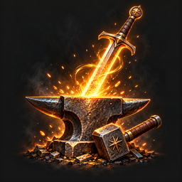

# Hero's Forge

<p align="center"></p>

Mod de Fabric para **Minecraft Java 26.3** para mejorar a tu personaje estilo RPG. Pagás **experiencia** y subís **puntos** de la estadística que quieras, hasta 100 en cada una: más vida, más daño (también con arco y ballesta), más armadura, regeneración, robo de vida, más salto… Cada punto cuesta siempre lo mismo: **30 puntos de experiencia**, y si te arrepentís, bajarlo te devuelve la mitad. Los puntos son tuyos para siempre: no se pierden al morir.

> Antes se llamaba **Estadísticas RPG**. Por dentro sigue con el id `estadisticasrpg` (el jar, `config/estadisticasrpg.json` y los puntos guardados), así que actualizar no le borra nada a nadie.

> **Estado:** versión 0.11.1. Las 15 estadísticas, bajar puntos con devolución, el menú, la pantalla propia, la config y los puntos compartidos con Soul Link están hechos. Probado a mano en un servidor junto con Soul Link y Bloodmoon & Bosses ([docs/plan.md](docs/plan.md)).

## En el juego

Valores por defecto (se cambian en la [config](#configuración)):

Cada estadística sube hasta **100 puntos**:

| Estadística | Id | Por punto | Con 100 puntos |
|---|---|---|---|
| Vida | `vida` | +0,3 corazones | +30 corazones |
| Daño (cuerpo a cuerpo) | `danio` | +0,25 | +25 |
| Daño a distancia (arco, ballesta y tridente lanzado) | `danio_distancia` | +1 % | +100 % |
| Armadura | `armadura` | +0,08 | +8 |
| Velocidad | `velocidad` | +0,2 % | +20 % |
| Velocidad de ataque | `velocidad_ataque` | +0,3 % | +30 % |
| Minado | `minado` | +1 % | +100 % |
| Alcance (a bloques y a mobs) | `alcance` | +0,02 bloques | +2 bloques |
| Resistencia al empuje | `empuje` | +0,5 % | +50 % |
| Suerte (al pescar) | `suerte` | +0,03 | +3 |
| Regeneración | `regeneracion` | +0,09 corazones por minuto | +9 corazones por minuto (medio corazón cada 3,3 segundos) |
| Robo de vida (cuerpo a cuerpo y a distancia) | `robo_de_vida` | +0,1 % del daño que hacés | +10 % |
| Salto | `salto` | +0,2 % de fuerza | +20 % (saltás 1,8 bloques) |
| Caída segura | `caida` | +0,1 bloques | +10 bloques de caída sin daño |
| Respiración | `respiracion` | +0,03 | +3 (como Respiración III) |

- **Se cobra en puntos de experiencia, no en niveles:** un nivel bajo vale 7 puntos y uno alto más de 100, así que cobrando niveles al principio se subía un punto cada dos o tres mobs. Con 30 de experiencia, el primer punto pide unos 6 zombis, y cuesta lo mismo estés en el nivel 2 o en el 40: no hace falta gastar apenas juntás ni conviene acumular.
- **El daño a distancia es aparte del daño:** el de cuerpo a cuerpo no les suma nada a las flechas (Minecraft no lo usa para los proyectiles). Multiplica el daño final de la flecha o el tridente, con Poder y el crítico incluidos, así que vale igual para el arco y la ballesta. No cuenta para los fuegos artificiales de la ballesta.
- **La regeneración no depende del hambre** y se suma a la de vanilla. El robo de vida cura una parte del daño que hacés de verdad (después de la armadura del mob), también con flechas y el tridente; el golpe que mata no cura.
- **El salto no pasa de 1,8 bloques** con los valores por defecto: no alcanza para saltar una pared de 2.
- Todo al máximo son 1500 puntos y 45.000 de experiencia.
- **Bajar puntos:** cada punto que bajás te devuelve **la mitad de lo que costó** (15 de experiencia). Sirve para cambiar de idea, pero mover los puntos según la pelea sale caro a propósito. Al bajar vida, la vida queda en el máximo nuevo.
- La compra baja la barra de experiencia, y si hace falta, el nivel.
- **Se compra lo que entra:** si pedís 5 y no te alcanza la experiencia o llegás al máximo antes, se compran los que se pueda y se cobran sólo esos.
- **Los puntos son para siempre:** se conservan al morir, al reconectar y al volver del End, y reaparecés con la vida llena contando los corazones extra.
- Al comprar vida, la vida nueva aparece llena.
- Comprar suena como subir de nivel y suelta unas chispas verdes; si no te alcanza o ya estás al máximo, suena el "no" del aldeano.
- **El modo creativo paga igual**: si no, alcanzaría con pasar a creativo, comprar todo y volver.

### El menú

`/estadisticas` (o `/stats`) abre un cofre con un ítem por estadística: manzana dorada (vida), espada (daño), arco (daño a distancia), peto (armadura), pluma (velocidad de ataque), lágrima de ghast (regeneración), redstone (robo de vida), azúcar (velocidad), pico (minado), caña de pescar (alcance), yunque (empuje), pata de conejo (suerte), bola de slime (salto), fardo de heno (caída segura) y pez globo (respiración). Arriba, una botella de experiencia muestra cuánta experiencia tenés (y en qué nivel estás).

- Están en dos filas: arriba las de combate y abajo las demás.
- **Click:** compra 1 punto. **Shift + click:** compra 5 (o los que entren).
- **Click derecho:** baja 1 punto y te devuelve la mitad de la experiencia. **Shift + click derecho:** baja 5.
- Cada ítem muestra tus puntos, el efecto que te dan, lo que suma el próximo y cuánto cuesta: en verde si te alcanza, en rojo si no. La botella de experiencia dice cuánto cuesta el próximo punto y cada cuántos puntos sube.
- Una estadística al máximo se ve como vidrio gris.
- Los ítems del menú son de muestra: no se pueden sacar, ni con doble click, arrastrando o con las teclas numéricas.
- Funciona con un cliente sin el mod: es un cofre común armado por el servidor.

### La pantalla propia (opcional, en el cliente)

Si además instalás el mod **en tu cliente**, tenés una pantalla propia para ver y subir las estadísticas, más cómoda que el cofre:

- **Se abre con la tecla K** (se cambia en *Opciones → Controles → Hero's Forge*), **o desde el inventario (E)** con el botón de la botella de experiencia que aparece al lado del libro de recetas. Con el inventario abierto, la K también la abre.
- Panel azul acero con bordes de bronce, botones integrados y dos grupos: **Combate** y **Exploración**. La experiencia y el costo tienen espacios separados; los números usan separadores de miles.
- Una fila por estadística: tus puntos, lo que te dan y una barra que se llena hasta el máximo. Pasando el mouse por una fila ves lo que suma el próximo punto, cuánto cuesta y cuánto te devuelve bajarlo.
- **Con la interfaz chica** (la escala automática en la mayoría de los monitores) van en dos columnas, combate a la izquierda y el resto a la derecha, y lo que te dan los puntos se ve pasando el mouse.
- **+1** compra 1 punto, **+5** compra 5 (o los que alcancen) y **-1** baja 1 y te devuelve la mitad. Arriba dice cuánta experiencia tenés, tu nivel y el costo por punto; abajo, cómo salió la última compra.
- Se actualiza sola mientras juntás experiencia o si un op te da puntos.
- `/estadisticas` también abre la pantalla en vez del cofre. **Ver como cofre** abre el cofre de siempre.
- Esc vuelve al inventario si la abriste desde ahí; la K o la E la cierran.
- **Es opcional:** el servidor cobra y valida todo igual, así que un jugador sin el mod en el cliente sigue usando el cofre y no se pierde nada. Si tenés el mod pero preferís el cofre, poné `"usarPantalla": false` en `config/estadisticasrpg-cliente.json` (de tu cliente): la tecla y el botón abren el cofre. Con `"botonEnInventario": false` se saca el botón del inventario.
- Hace falta que el servidor tenga la misma versión del mod (o una más nueva): si no, la tecla avisa que el servidor no la tiene. Con un cliente de una versión anterior a la del servidor, `/estadisticas` abre el cofre.
- El inventario del modo creativo es otra pantalla y no tiene el botón: ahí está la K.

### Comandos

| Comando | Qué hace | Quién |
|---|---|---|
| `/estadisticas` o `/stats` | Abre el menú | todos |
| `/estadisticas ver [jugador]` | Tus puntos (o los de otro jugador) en el chat: efecto de cada estadística, cuánto cuesta un punto y cuánta experiencia tenés | todos (otro jugador: op) |
| `/estadisticas subir <estadística> [cantidad]` | Compra puntos (por defecto, 1) | todos |
| `/estadisticas bajar <estadística> [cantidad]` | Baja puntos (por defecto, 1) y te devuelve la mitad de la experiencia | todos |
| `/estadisticas dar <jugador> <estadística> <cantidad>` | Da puntos sin cobrar, hasta el máximo | op |
| `/estadisticas reiniciar <jugador>` | Pone todo en 0 sin devolver la experiencia | op |
| `/estadisticas recargar` | Vuelve a leer `config/estadisticasrpg.json` y lo aplica a los que están conectados | op |

`/stats` sirve en lugar de `/estadisticas` en todos.

## Configuración

Al arrancar por primera vez, el servidor crea `config/estadisticasrpg.json` con los valores por defecto:

```json
{
  "experienciaPorPunto": 30,
  "devolucionAlBajar": 0.5,
  "estadisticas": {
    "vida": { "porPunto": 0.6, "tope": 100 },
    "danio": { "porPunto": 0.25, "tope": 100 },
    ...
  }
}
```

| Campo | Qué es |
|---|---|
| `experienciaPorPunto` | Puntos de experiencia (no niveles) que cuesta cada punto, siempre los mismos (entero, 0 o más; con 0 es gratis) |
| `devolucionAlBajar` | Qué parte de `experienciaPorPunto` te devuelve bajar un punto, de 0 a 1 (`0.5` = la mitad; redondea para abajo). Con 0, bajar no devuelve nada |
| `porPunto` | Cuánto suma cada punto, en las unidades del atributo de Minecraft: la vida va en medios corazones (`0.6` = 0,3 corazones), la regeneración en medios corazones por segundo (`0.003`), y los porcentajes como fracción (`0.002` = 0,2 %). Mayor que 0 |
| `tope` | Máximo de puntos de esa estadística (entero, 0 o más; con 0 no se puede comprar) |

- Después de editarlo, `/estadisticas recargar` lo aplica sin reiniciar el servidor.
- **Un valor inválido no rompe nada:** se usa el de por defecto para ese campo y `recargar` (o el log, al arrancar) dice cuál. Si el JSON está roto, se sigue usando la config anterior y el archivo no se toca.
- Si le falta una estadística o un campo (por ejemplo, después de actualizar el mod), se agrega solo al archivo con su valor por defecto.
- **Desde la 0.7.0 ya no existen `costoPorPunto` ni `puntosPorAumento`** (el costo en niveles): un archivo de antes se reescribe solo, sin esas claves y con `experienciaPorPunto`.
- **Al actualizar el mod, un archivo que ya existe no cambia:** se siguen usando los números que tenga. Para pasar a los valores por defecto nuevos, borralo y usá `/estadisticas recargar` (o reiniciá).
- **Bajar un tope no le quita puntos a nadie:** los de más se guardan pero no suman, y vuelven a contar si lo subís de nuevo.

## Con Bloodmoon & Bosses

Los valores por defecto están pensados para jugar junto con Bloodmoon & Bosses, el mod en el que los mobs tienen niveles del 1 al 100 según lo lejos que estén del spawn. Las dos cosas escalan de la mano: con el equipo y los puntos que se esperan en cada zona, un zombi se mata en 5 o 6 golpes en todo el mundo, y lo que aguantás va bajando hacia la zona de nivel 100.

| Zona | Equipo | Puntos (del total de 1000) | Golpes para matar un zombi | Flechas para matar un zombi | Golpes de zombi que aguantás (en difícil) |
|---|---|---|---|---|---|
| Nivel 10 | hierro, arco sin encantar | 10 % | 5 | 5 | 5 |
| Nivel 25 | diamante, arco con Poder III | 25 % | 5 | 4 | 12 |
| Nivel 50 | netherita con Filo V y Protección IV, arco con Poder V | 50 % | 5 | 4 | 22 |
| Nivel 75 | netherita con Filo V y Protección IV, arco con Poder V | 75 % | 6 | 5 | 19 |
| Nivel 100 | netherita con Filo V y Protección IV, arco con Poder V | 100 % | 6 | 6 | 16 |

La tabla cuenta las 10 estadísticas de antes de la 0.10.0: la regeneración y el robo de vida hacen que aguantes un poco más.

Sin puntos, en la zona de nivel 100 hacen falta 19 golpes de netherita o 12 flechas de Poder V para matar un zombi, y aguantás 3 golpes. Las flechas son con el arco tensado del todo (siempre crítico), en promedio.

La tabla es por la distancia. Bloodmoon & Bosses además suma 1 nivel cada 5 días del mundo (hasta +20 a los 100 días) y hace aparecer campeones con +10 niveles (uno de cada 20): con el mundo más viejo, los puntos hacen más falta también cerca de la base.

## Con Soul Link

Si en el servidor también está Soul Link (el mod que comparte inventario, vida y experiencia entre todos los jugadores), **los puntos también son de todos**: lo que compra uno lo tienen todos, al momento.

- Se activa solo al detectar el mod; no hay que configurar nada. El menú lo avisa en la botella de experiencia.
- **Las compras se sincronizan al momento:** si dos jugadores compran en el mismo tick, el segundo ya ve lo que gastó el primero.
- **Bajar vida, reiniciar o recargar un tope menor recorta la barra compartida una sola vez**, sin sumar el recorte como daño por cada jugador.
- **La experiencia es la compartida**, así que comprar gasta la del grupo, como cualquier otro gasto.
- Todos tienen la misma vida máxima, así que la vida compartida no se corta.
- **La regeneración cura una sola vez para todo el grupo**, no una vez por jugador. El robo de vida cura al que pega, y Soul Link se lo pasa a todos.
- Bajar puntos los baja para todos, y la experiencia que devuelve va a la del grupo.
- `ver`, `dar` y `reiniciar` hablan del grupo: `reiniciar` con cualquier jugador pone en 0 los puntos de todos.
- **Los puntos que cada uno tenía antes se suman al grupo** la primera vez que entra: por estadística, el máximo entre lo del grupo y lo suyo (no la suma, para no pasar el tope). Pasa una sola vez por jugador.
- Los puntos individuales no se borran: si se saca Soul Link, cada uno vuelve a tener los suyos.

## Requisitos

| | Versión |
|---|---|
| Minecraft Java | 26.3 |
| [Fabric Loader](https://fabricmc.net/use/) | 0.19.5 o más nuevo |
| [Fabric API](https://modrinth.com/mod/fabric-api) | para 26.3 |
| Java | 25 |

## Instalación

Toda la lógica corre en el servidor.

- **Servidor dedicado:** copiá `estadisticasrpg-<versión>.jar` y Fabric API a la carpeta `mods/` del servidor. Los jugadores no necesitan instalar nada.
- **Singleplayer o LAN:** instalalo en el cliente del que abre el mundo, junto con Fabric API.
- **Para tener [la pantalla propia](#la-pantalla-propia-opcional-en-el-cliente):** el mismo jar, junto con Fabric API, en la carpeta `mods/` de tu cliente. Es opcional y cada jugador decide.

## Compilar

```bash
./gradlew build          # Windows: gradlew build
```

El jar queda en `build/libs/`.

El proyecto pide Java 25 (`gradle/gradle-daemon-jvm.properties`). Si Gradle no encuentra tu JDK 25, agregá a tu `~/.gradle/gradle.properties` (el global, no el del repo) la línea `org.gradle.java.installations.paths=<ruta a tu JDK 25>`.

## Probar

```bash
./gradlew runGameTest          # pruebas automáticas en un servidor sin ventana
./gradlew runClientGameTest    # prueba la pantalla propia en un cliente de verdad (abre una ventana)
```

Las pruebas verifican que:

- comprar cobra la experiencia justa, sube el atributo y llena la vida nueva;
- un punto cuesta la misma experiencia en el nivel 0 que en el 30, y la cuenta de experiencia por nivel coincide con la de vanilla;
- sin experiencia suficiente o en el máximo no se cobra nada, y si pedís de más se compra lo que entra;
- bajar devuelve la mitad de lo que costó, baja la vida máxima (sin dejar vida de más) y, sin puntos, no devuelve nada;
- el salto, la caída segura y la respiración dan los valores de la tabla; la regeneración cura cada segundo y el robo de vida cura al pegar, pero no con golpes de otros;
- aplicar los puntos dos veces no los apila;
- al morir y reaparecer se conservan los puntos, la vida máxima y la vida llena; al volver del End, también la vida que tenías;
- guardar y cargar al jugador conserva los puntos y la vida (aunque sea más de 20);
- una estadística desconocida en el archivo guardado no borra las demás;
- `reiniciar` deja todo en 0 y la vida no queda por encima del máximo;
- los comandos `subir`, `bajar`, el alias `/stats`, `dar` y `recargar` funcionan, y `dar` sólo para op;
- en el menú, un click compra 1, shift + click compra 5, el click derecho baja 1 y shift + click derecho baja 5, y ningún ítem de muestra se puede sacar (doble click, arrastrar, teclas numéricas, tirar) ni se puede meter nada;
- las estadísticas al máximo dan los valores de la tabla, y las que tiene que ver el cliente (velocidad, velocidad de ataque, minado, alcance y salto) se le mandan al cliente vanilla;
- con 100 puntos de daño a distancia, una flecha y un tridente lanzado pegan el doble, y una flecha sin dueño pega como en vanilla;
- toda estadística tiene sus números en la config y su lugar en el menú (las de combate en la fila de arriba);
- con Soul Link, lo que compra uno lo tienen todos, los puntos individuales se suman al grupo una sola vez y se conservan al reaparecer (las pruebas fuerzan el modo: no cargan Soul Link de verdad);
- la config se crea con los valores por defecto (y una devolución de más de 1 se rechaza), respeta lo que cambiaste, avisa de lo inválido sin pisarlo, completa lo que falta, no usa un JSON roto, y un cambio se aplica a los que están conectados;
- lo que el servidor le manda a la pantalla propia tiene los puntos, topes y textos de cada estadística y llega igual por la red; un pedido de compra o de bajar trucho (cantidad negativa o 0, estadística que no existe) no cobra, no da ni devuelve nada; y sin el mod en el cliente `/estadisticas` abre el cofre;
- en un cliente de verdad (`runClientGameTest`): la K abre la pantalla, **+1** compra y cobra la experiencia justa, **-1** baja y devuelve la mitad, el botón del inventario y la K desde el inventario la abren, Esc y **Listo** vuelven al inventario, y las filas entran con la interfaz más chica. Deja capturas en `build/run/clientGameTest/screenshots`.

Para probar a mano, mirá [claude/general/probar-en-el-juego.md](claude/general/probar-en-el-juego.md).

## Estructura

```
src/main/       el mod (lo que corre en el servidor, y los paquetes de red de la pantalla)
src/client/     la pantalla propia, que sólo existe en el cliente
src/gametest/   pruebas automáticas (Fabric GameTest, del servidor y del cliente)
claude/         documentación técnica para agentes de IA (invariantes, decisiones y bugs ya resueltos)
docs/           el plan del mod por fases
```

Para entender por qué el código está hecho así, empezá por [CLAUDE.md](CLAUDE.md) y [claude/mod/INDICE.md](claude/mod/INDICE.md).

## Licencia

[MIT](LICENSE): podés usarlo, modificarlo y redistribuirlo (también en modpacks) siempre que mantengas el aviso de copyright.

Para probar la integración real con Soul Link 1.2.1 (cuatro jugadores, recortes de vida y compras en el mismo tick):

```powershell
.\gradlew.bat runGameTest "-PsoulLinkJar=../SoulLink/build/libs/soullink-1.2.1.jar"
```

El jar se usa sólo en la prueba; no se incluye en Hero's Forge.
