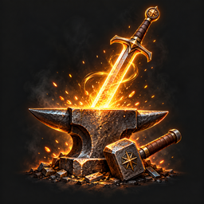

# Hero's Forge

<p align="center"></p>

Mod de Fabric para **Minecraft Java 26.3** para mejorar a tu personaje estilo RPG. Pagás **experiencia** y subís **puntos** de la estadística que quieras, hasta 100 en cada una. Son **40 estadísticas en 5 ramas**: más vida, más daño (también con arco y ballesta), críticos, esquiva, un escudo que se recarga, menos hambre, un imán para los ítems, descuentos con los aldeanos… Cada punto cuesta **30 puntos de experiencia**, y si te arrepentís, bajarlo te devuelve la mitad. Los puntos son tuyos para siempre: no se pierden al morir.

## Estadísticas

Las ramas sólo ordenan: no hay nada bloqueado y cualquier estadística se compra desde el principio. Todo al máximo son 4000 puntos (120.000 de experiencia), así que hay que elegir. Valores por defecto (se cambian en la [config](#configuración)):

### Guerrero

| Estadística | Id | Por punto | Con 100 puntos |
|---|---|---|---|
| Daño (cuerpo a cuerpo) | `danio` | +0,25 | +25 |
| Velocidad de ataque | `velocidad_ataque` | +0,3 % | +30 % |
| Daño a distancia (arco, ballesta, tridente lanzado) | `danio_distancia` | +1 % | +100 % |
| Destreza (tensar arcos y ballestas) | `destreza` | +0,4 % de velocidad | +40 % |
| Barrido (el de la espada) | `barrido` | +0,5 % del daño | +50 % |
| Golpe contundente | `golpe` | +0,01 de empuje | +1 (como Empuje I) |
| Crítico | `critico` | +0,2 % de probabilidad | 20 % de pegar +50 % |
| Ejecución | `ejecucion` | +0,5 % de daño | +50 % a enemigos con menos del 30 % de vida |

### Guardián

| Estadística | Id | Por punto | Con 100 puntos |
|---|---|---|---|
| Vida | `vida` | +0,3 corazones | +30 corazones |
| Armadura | `armadura` | +0,08 | +8 |
| Resistencia al empuje | `empuje` | +0,5 % | +50 % |
| Dureza (de armadura) | `dureza` | +0,08 | +8 |
| Antiexplosión (empuje de las explosiones) | `antiexplosion` | +0,5 % | +50 % |
| Resistencias (fuego, explosiones y magia) | `resistencias` | −0,3 % de daño | −30 % |
| Represalia | `represalia` | 0,3 % del daño cuerpo a cuerpo | le devolvés el 30 % al que te pega |
| Escudo | `escudo` | +0,04 corazones | 4 corazones de absorción que se recargan |
| Esquiva | `esquiva` | +0,15 % de probabilidad | 15 % de no recibir un ataque |

### Superviviente

| Estadística | Id | Por punto | Con 100 puntos |
|---|---|---|---|
| Regeneración | `regeneracion` | +0,09 corazones por minuto | +9 corazones por minuto |
| Robo de vida | `robo_de_vida` | +0,1 % del daño que hacés | +10 % |
| Metabolismo | `metabolismo` | −0,5 % de hambre | −50 % (la barra baja a la mitad de velocidad) |
| Nutrición | `nutricion` | +0,5 % de lo que llena la comida | +50 % |
| Glotón | `gloton` | −0,5 % del tiempo para comer y beber | la mitad del tiempo |
| Tenacidad | `tenacidad` | −0,5 % de duración de los efectos negativos | la mitad (veneno, wither, debilidad…) |
| Ignífugo | `ignifugo` | −0,5 % de tiempo prendido fuego | la mitad |
| Respiración | `respiracion` | +0,03 | +3 (como Respiración III) |

### Explorador

| Estadística | Id | Por punto | Con 100 puntos |
|---|---|---|---|
| Velocidad | `velocidad` | +0,2 % | +20 % |
| Salto | `salto` | +0,2 % de fuerza | +20 % (1,8 bloques) |
| Caída segura | `caida` | +0,1 bloques | +10 bloques sin daño |
| Paso (subir escalones sin saltar) | `paso` | +0,005 bloques | +0,5: subís bloques enteros caminando |
| Nado | `nado` | −0,5 % de lo que frena el agua | −50 % (media Agilidad acuática III) |
| Sigilo (agachado) | `sigilo` | +0,4 % de la velocidad normal | del 30 % al 70 % |
| Ligereza | `ligereza` | −0,25 % de gravedad | −25 %: saltás un poco más y caés más lento |

### Artesano

| Estadística | Id | Por punto | Con 100 puntos |
|---|---|---|---|
| Minado | `minado` | +1 % | +100 % |
| Minado submarino | `minado_submarino` | +0,8 % de la velocidad normal | +80 % (como Afinidad acuática) |
| Alcance (a bloques y a mobs) | `alcance` | +0,02 bloques | +2 bloques |
| Suerte (al pescar) | `suerte` | +0,03 | +3 |
| Imán | `iman` | +0,06 bloques | atraés ítems y experiencia a 6 bloques |
| Cuidado del equipo | `cuidado_del_equipo` | +0,5 % de probabilidad | 50 % de no gastar durabilidad |
| Regateo | `regateo` | −0,3 % en los precios | −30 % (como Héroe de la aldea I) |
| Sabiduría | `sabiduria` | +0,25 % de experiencia de los orbes | +25 % |

- **Se cobra en puntos de experiencia, no en niveles:** un punto cuesta lo mismo en el nivel 2 que en el 40. La compra baja la barra y, si hace falta, el nivel.
- **Se compra lo que entra:** si pedís 5 y te alcanza para 3, se compran y se cobran 3.
- **Bajar un punto devuelve la mitad** de lo que costó: sirve para cambiar de idea, pero mover los puntos según la pelea sale caro.
- **Los puntos son para siempre:** se conservan al morir, al reconectar y al volver del End.
- El daño a distancia multiplica el daño final de la flecha o el tridente (con Poder y el crítico). La regeneración no depende del hambre. El robo de vida cura una parte del daño que hacés, también con flechas, y el golpe que mata no cura.
- El crítico y la ejecución valen también con flechas. Los críticos se ven con las partículas de siempre.
- La esquiva sólo esquiva ataques de algo (un mob, una flecha, otro jugador): la lava, las caídas y el vacío entran igual. La represalia es sólo cuerpo a cuerpo.
- El escudo se recarga medio corazón por segundo después de 5 segundos sin recibir daño.
- Con la destreza y el glotón, el cliente sigue mostrando la animación de siempre, pero la flecha sale con la fuerza del tiempo acelerado y la comida se termina antes.
- El imán no atrae mientras vas agachado, ni lo que acabás de tirar.
- La sabiduría suma sólo a los orbes: la experiencia que devuelve bajar un punto no cambia.
- El modo creativo paga igual.

## Cómo se suben

### El menú (sin instalar nada)

`/estadisticas` (o `/stats`) abre un cofre con las 5 ramas. Click en una rama abre su página: sus estadísticas en el medio y las 5 ramas abajo, para pasar de una a otra. La flecha de arriba a la izquierda vuelve a la portada.

- **Click:** compra 1 punto. **Shift + click:** compra 5.
- **Click derecho:** baja 1 y devuelve la mitad. **Shift + click derecho:** baja 5.
- Cada ítem muestra tus puntos, lo que te dan, lo que suma el próximo y cuánto cuesta (en verde si te alcanza).
- Funciona con un cliente vanilla: es un cofre armado por el servidor.

### La pantalla propia (opcional, en el cliente)

Si también instalás el mod **en tu cliente**, tenés una pantalla propia, más cómoda que el cofre:

- Se abre con la **K** (se cambia en *Opciones → Controles → Hero's Forge*) o con el botón de la botella de experiencia del inventario.
- Una pestaña por rama y, en cada una, botones **+1**, **+5** y **-1** por estadística, con lo que suma el próximo punto, el costo y la devolución al pasar el mouse. Se actualiza sola y recuerda la última pestaña.
- **Ver como cofre** abre el menú de siempre. Si preferís el cofre, poné `"usarPantalla": false` en `config/herosforge-cliente.json` de tu cliente.
- Hace falta que el servidor tenga la misma versión del mod. Con la 0.13.0 cambió lo que se mandan (ahora viajan las ramas): un cliente anterior con un servidor nuevo usa el cofre, y uno nuevo con un servidor anterior avisa al apretar la K.

## Comandos

| Comando | Qué hace | Quién |
|---|---|---|
| `/estadisticas` o `/stats` | Abre el menú | todos |
| `/estadisticas ver [jugador]` | Tus puntos (o los de otro) en el chat, por rama | todos (otro jugador: op) |
| `/estadisticas subir <estadística> [cantidad]` | Compra puntos | todos |
| `/estadisticas bajar <estadística> [cantidad]` | Baja puntos y devuelve la mitad | todos |
| `/estadisticas dar <jugador> <estadística> <cantidad>` | Da puntos sin cobrar | op |
| `/estadisticas reiniciar <jugador>` | Pone todo en 0 sin devolver la experiencia | op |
| `/estadisticas recargar` | Vuelve a leer la config | op |

## Configuración

`config/herosforge.json` se crea en el primer arranque. Después de editarlo, `/estadisticas recargar` lo aplica sin reiniciar.

| Campo | Qué es |
|---|---|
| `experienciaPorPunto` | Experiencia que cuesta cada punto (0 = gratis) |
| `devolucionAlBajar` | Qué parte del costo devuelve bajar un punto, de 0 a 1 |
| `estadisticas.<id>.porPunto` | Cuánto suma cada punto, en las unidades de Minecraft: la vida y el escudo en medios corazones (`0.6` = 0,3 corazones) y los porcentajes y probabilidades como fracción (`0.002` = 0,2 %). Lo que baja (hambre, precios, gravedad…) también va en positivo: `0.005` = −0,5 % |
| `estadisticas.<id>.tope` | Máximo de puntos de esa estadística |

Un valor inválido usa el de por defecto y lo avisa; un JSON roto se ignora y sigue la config anterior. Bajar un tope no le quita puntos a nadie: los de más dejan de sumar. Las probabilidades y las reducciones no pasan del 100 % aunque la config dé más.

Al actualizar a la 0.13.0, las 25 estadísticas nuevas se agregan solas a un `herosforge.json` que ya existe, sin tocar lo que cambiaste.

## Funciona con

- **Bloodmoon & Bosses:** los valores por defecto están balanceados contra sus mobs de nivel 1 a 100. Con el equipo y los puntos que se esperan en cada zona, un zombi se mata en 5 o 6 golpes en todo el mundo.
- **Soul Link** (3.0.0 o más nuevo): los puntos son de cada grupo vinculado. Lo que compra uno lo tiene todo su grupo, la compra gasta la experiencia compartida y la regeneración cura una sola vez por grupo. Si armás grupos (por ejemplo 2 y 2), cada uno tiene sus puntos, y el que cambia de grupo pasa a tener los del grupo nuevo. Los puntos que cada uno tenía antes se suman al grupo (el máximo por estadística) la primera vez que entra.
- **Mythic Loot:** el robo de vida y el daño a distancia se suman a los afijos de sus armas.

## Requisitos e instalación

Minecraft Java 26.3, [Fabric Loader](https://fabricmc.net/use/) 0.19.5 o más nuevo, [Fabric API](https://modrinth.com/mod/fabric-api) y Java 25.

- **Servidor:** copiá `herosforge-<versión>.jar` y Fabric API a `mods/`. Los jugadores no necesitan nada.
- **Singleplayer o LAN:** en el cliente del que abre el mundo, junto con Fabric API.
- **Pantalla propia:** el mismo jar en `mods/` de tu cliente. Es opcional.

### Actualizar desde una versión anterior a la 0.12.0

Hasta la 0.11.1 el id era `estadisticasrpg` (el mod antes se llamaba Estadísticas RPG). Borrá el jar viejo y poné el nuevo: **los puntos de cada jugador, los del grupo y la config se pasan solos** al id nuevo. Quien use la pantalla propia tiene que actualizar también el jar de su cliente, y si había cambiado la tecla, volver a asignarla. Por las dudas, hacé una copia del mundo antes.

## Desarrollo

```bash
./gradlew build                # compila y corre las pruebas; el jar queda en build/libs/
./gradlew runGameTest          # pruebas automáticas en un servidor sin ventana
./gradlew runClientGameTest    # prueba la pantalla en un cliente de verdad (abre una ventana)
./gradlew runGameTest -PsoulLinkJar=../SoulLink/build/libs/soullink-3.0.0.jar   # integración con Soul Link real
```

Pide Java 25: si Gradle no encuentra tu JDK, agregá `org.gradle.java.installations.paths=<ruta a tu JDK 25>` a tu `~/.gradle/gradle.properties`. La documentación técnica está en [CLAUDE.md](CLAUDE.md).

## Licencia

[MIT](LICENSE).
